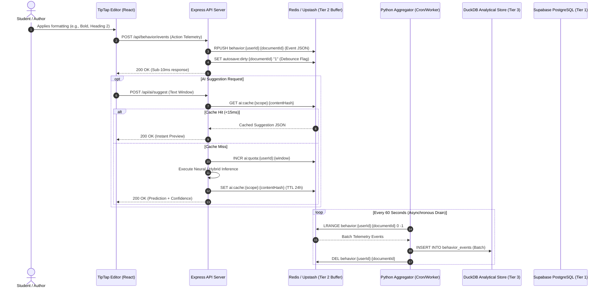
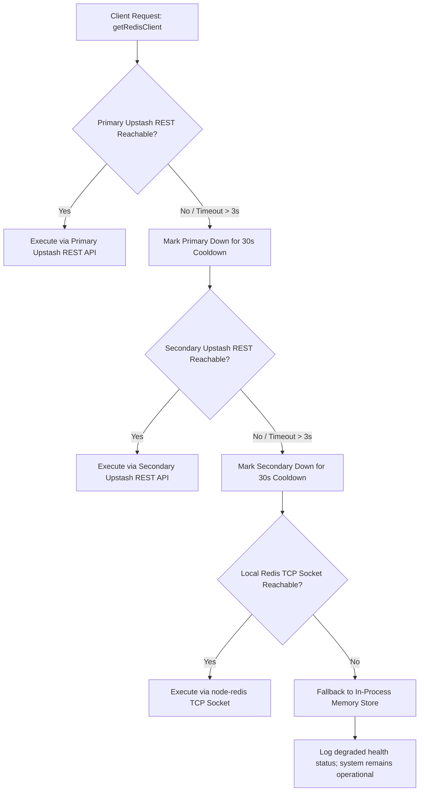

# IntelliDocs Manuscript — Database Design Guide
## Part 2: In-Memory Key-Value Buffer & High-Speed Caching Layer (Redis / Upstash)

> **Document Context:** Chapter 3 (System Architecture & Software Design) — Subsection 3.3: Database Design (Tier 2: In-Memory Key-Value Buffer & Cache)  
> **Target System:** IntelliDocs — Intelligent Web-Based Document Editor  
> **Underlying Engine:** Redis 7+ / Upstash Serverless REST Redis (with Multi-Tier Failover Chain)  
> **Source Implementation:** `server/src/utils/redisClient.ts`, `server/src/models/behaviorModel.ts`, `server/src/models/aiQuotaModel.ts`, `server/src/models/aiCacheModel.ts`, `server/src/models/importJobModel.ts`

---

### 1. Architectural Purpose & Theoretical Justification

In high-concurrency, real-time web applications, relying solely on an ACID relational database (like PostgreSQL) for high-frequency keystroke logging and transient state creates severe performance bottlenecks. **Redis** serves as the **Tier 2 volatile in-memory datastore and telemetry buffer** within IntelliDocs for five key reasons:

1. **Sub-Millisecond Keystroke & Formatting Telemetry Buffering:** As users type and apply formatting in the TipTap ProseMirror editor, micro-events (bold, italics, heading toggles, table insertion, list indentations) fire continuously. Writing each micro-event synchronously to PostgreSQL would exhaust database connection pools. Redis buffers these events in in-memory lists in under 2 milliseconds, later drained by an analytical aggregator.
2. **AI Suggestion & Inference Latency Reduction:** Large Language Model (LLM) prompts and hybrid machine learning inferences take between 800ms and 3,500ms. By caching deterministic suggestions against content hashes in Redis with time-to-live (TTL) expiration, subsequent edits over similar structural windows respond in `< 15ms`.
3. **Distributed Rate Limiting & AI Quota Metering:** Strict daily token and call quotas (e.g., Free users: 50 daily requests; Students: 200; Professors: 500) require atomic increment counters (`INCR`) with automatic rolling window expiration (`EXPIRE`) across distributed Node.js worker processes.
4. **Debounced Autosave Dirty Flag Management:** Rapid typing produces transient dirty document states. Redis holds lightweight dirty flags that debounce saves to PostgreSQL, ensuring database writes occur only after the user pauses for a predefined interval (e.g., 1,500ms).
5. **Decoupled Asynchronous Import Queues:** Large file imports (100+ page DOCX/PDF manuscripts) run as background workers. Redis queues track job status, chunks, and error logs, enabling non-blocking frontend progress polling.

---

### 2. Architecture & Data Flow Diagram

The following Mermaid sequence diagram models the lifecycle of real-time editing telemetry and AI caching within the Redis in-memory layer:



---

### 3. Redis Key-Value Schema & Data Dictionary

The table below documents every key pattern, data structure, TTL strategy, payload shape, and system role utilized in the Redis layer.

| Key Pattern | Data Structure | TTL / Expiration | Payload / Value Shape | Subsystem & Purpose |
| :--- | :--- | :--- | :--- | :--- |
| `behavior:{userId}:{documentId}` | **List** | None (Flushed on aggregation) | Serialized JSON array of `StoredBehaviorEvent` objects | **Telemetry Buffer:** Holds raw user editing and formatting actions before bulk drainage into DuckDB. |
| `behavior:patterns:{userId}:{genre}` | **String** | `5,184,000s` (60 Days) | Serialized JSON mapping of `{ textPattern: { format, frequency, confidence } }` | **Learned Patterns:** Fast-path cache of user format preferences partitioned by document genre. |
| `ai:cache:{scope}:{hash}` | **String** | `86,400s` (24 Hours) | Serialized JSON: `{ suggestion, confidence, provider, reasoning }` | **Inference Cache:** Deduplicates expensive LLM and ML inference calls over identical structural contexts. |
| `ai:quota:{userId}:{window}` | **String** (Counter) | `86,400s` (Rolling Day) | Integer string (e.g., `"42"`) | **Rate Limiter:** Tracks daily AI calls consumed; incremented atomically via `INCR`. |
| `autosave:dirty:{documentId}` | **String** | `300s` (5 Minutes) | Integer string (`"1"`) | **Debounce Engine:** Flags documents currently undergoing active keystrokes, deferring SQL updates. |
| `assistant:route:{userId}:{id}` | **String** | `600s` (10 Minutes) | Serialized JSON: `{ message, tool, args, targetRange }` | **NLP Action Router:** Holds pending interactive chatbot modifications awaiting user confirmation. |
| `assistant:route:log:{userId}` | **List** | `86,400s` (24 Hours) | Serialized JSON array of executed assistant tool operations | **Audit Log:** Captures recent conversational actions for review and rollback tracking. |
| `citation:search:{queryHash}` | **String** | `259,200s` (3 Days) | Serialized JSON array of CrossRef / Semantic Scholar metadata | **Citation Cache:** Shields external academic APIs from repetitive bibliographic queries. |
| `import:job:{jobId}` | **String** | `7,200s` (2 Hours) | Serialized JSON: `{ status, progress, totalPages, error, result }` | **Import State Machine:** Stores asynchronous progress for large thesis DOCX and PDF parsing jobs. |
| `import:jobs:user:{userId}` | **List** | `7,200s` (2 Hours) | Array of UUID job IDs belonging to the user | **User Import Index:** Powers user's active background import progress bars in the dashboard. |
| `import:jobs:queue` | **List** (FIFO Queue) | `7,200s` (2 Hours) | Array of UUID job IDs awaiting worker processing | **Job Queue:** Distributed task queue consumed by Python FastAPI import worker processes. |

---

### 4. Telemetry Event Payload Structure

Events appended to `behavior:{userId}:{documentId}` follow a strict JSON schema that preserves both raw text context and rich media parameters:

```json
{
  "userId": "e4b2d3c1-7f89-4a0b-9c2d-1e3f4a5b6c7d",
  "documentId": "a1b2c3d4-e5f6-7a8b-9c0d-1e2f3a4b5c6d",
  "genre": "thesis",
  "action": "table_row_add",
  "blockId": "block-9481-xyz",
  "timestamp": "2026-11-23T02:15:30.124Z",
  "payload": {
    "text": "Table 4.1: Demographic Breakdown",
    "tableRows": 8,
    "tableCols": 5,
    "alignment": "center",
    "fromSuggestion": false
  }
}
```

#### Field Specifications:
- `genre`: Identifies the genre partition (`'ieee'`, `'thesis'`, `'memo'`, `'general'`). A thesis formatting pattern is never allowed to pollute memo or journal prediction models.
- `fromSuggestion`: Boolean flag indicating whether the action was accepted from an AI prompt. Accepted suggestions are excluded from reinforcing their own confidence to avoid self-reinforcing bias loops.
- `payload`: Flexible object storing contextual attributes (image dimensions, table row/column counts, indentation depths) utilized by feature extraction pipelines.

---

### 5. High Availability, Failover Chain, and Circuit Breaking

Because Redis handles real-time editing interactions, any downtime or network partitions to a cloud cache provider must never crash the editor or drop student work. `server/src/utils/redisClient.ts` implements a **4-tier automatic failover chain**:



#### Key Resilience Mechanics:
1. **Call-Level Timeout Circuit Breaker:** Any call taking longer than `3,000ms` is aborted and counts as a backend failure, preventing hung network requests from stalling the HTTP request pipeline.
2. **Coordinated Cooldown Period:** A failing backend is bypassed for `30,000ms` (30 seconds) before a retry is attempted, avoiding repetitive connection latency on every keystroke during an outage.
3. **In-Process Memory Compatibility Layer:** If all remote and local Redis instances are unreachable, an in-memory `Map`-backed store transparently satisfies `get`, `set`, `rPush`, `lRange`, `incr`, and `expire`, ensuring the application remains 100% operational during cloud outages.
4. **Readiness Probe Monitoring:** The `/health/ready` endpoint reports the active backend and skips unready instances, guaranteeing zero-downtime rolling deployments on platforms like Render.
