# IntelliDocs Manuscript — Database Design Guide
## Part 1: Relational & Transactional Datastore (Supabase / PostgreSQL)

> **Document Context:** Chapter 3 (System Architecture & Software Design) — Subsection 3.3: Database Design (Tier 1: Relational OLTP Store)  
> **Target System:** IntelliDocs — Intelligent Web-Based Document Editor  
> **Underlying Engine:** Supabase PostgreSQL 15+ (with `pgvector`, Row-Level Security, Realtime, and Supabase Storage)  
> **Source Schema Files:** `db/supabase/000_users_reference.sql` through `db/supabase/051_caption_config.sql` (Consolidated in `_apply_all_generated.sql`)

---

### 1. Architectural Purpose & Theoretical Justification

In the multi-tier data architecture of IntelliDocs, **Supabase PostgreSQL** serves as the **authoritative transactional datastore (OLTP)** and **identity/access governance engine**. Modern document editing systems require strong consistency, strict relational integrity, and robust security policies for several critical reasons:

1. **ACID Transactional Integrity:** Document creation, multi-chapter tab splitting, version snapshots, and folder hierarchical reorganizations demand atomic, consistent, isolated, and durable operations to prevent orphaned documents or partial tree mutations.
2. **Fine-Grained Row-Level Security (RLS):** By delegating data access control to database-native RLS policies evaluated directly against the authenticated user's JWT (`auth.uid()`), unauthorized cross-tenant data leaks and privilege escalations are prevented even in the event of client-side or controller-level misconfiguration.
3. **Structured Document Hierarchy:** A document is modeled not as a monolithic unstructured blob, but as a structured entity comprising document metadata, multi-tab chapter bodies (`document_tabs`), revision history (`document_versions`), shared access permissions (`document_shares`), and media tracking (`stored_images`).
4. **Vector Embedding Storage (`pgvector`):** High-dimensional document and citation embeddings are indexed alongside relational metadata, enabling semantic originality verification and contextual citation retrieval without requiring an external vector database.

---

### 2. Entity-Relationship Diagram (ERD)

The following Mermaid entity-relationship diagram illustrates the primary relational entities, cardinality, and foreign key references within the Supabase PostgreSQL schema.

```mermaid
erDiagram
    USERS ||--o{ USER_PROFILES : "extends"
    USERS ||--o{ DOCUMENTS : "owns"
    USERS ||--o{ FOLDERS : "creates"
    USERS ||--o{ DOCUMENT_PINS : "pins"
    USERS ||--o{ DOCUMENT_OPENS : "tracks"
    USERS ||--o{ STORED_IMAGES : "uploads"
    USERS ||--o{ USER_PRESETS : "configures"
    USERS ||--o{ GOOGLE_TOKENS : "authenticates"
    USERS ||--o{ NOTIFICATIONS : "receives"
    
    ROLES ||--o{ USER_PROFILES : "assigns"
    
    DOCUMENTS ||--o{ DOCUMENT_TABS : "partitions"
    DOCUMENTS ||--o{ DOCUMENT_VERSIONS : "archives"
    DOCUMENTS ||--o{ DOCUMENT_SHARES : "authorizes"
    DOCUMENTS ||--o{ DOCUMENT_COMMENTS : "contains"
    DOCUMENTS ||--o{ DOCUMENT_REVIEWS : "evaluated_by"
    DOCUMENTS ||--o{ FORMATTING_ACTIONS : "logs"
    DOCUMENTS ||--o{ AI_SUGGESTIONS : "receives"
    DOCUMENTS ||--o{ GRAMMAR_ISSUES : "detects"
    DOCUMENTS ||--o{ PLAGIARISM_SCANS : "scanned_for"
    DOCUMENTS ||--o{ STORED_IMAGES : "references"
    DOCUMENTS ||--o{ DOCUMENT_PINS : "pinned_in"
    DOCUMENTS ||--o{ DOCUMENT_OPENS : "opened_in"
    
    FOLDERS ||--o{ FOLDERS : "nests (parent_id)"
    FOLDERS ||--o{ FOLDER_DOCUMENTS : "categorizes"
    DOCUMENTS ||--o{ FOLDER_DOCUMENTS : "located_in"
    
    AI_SUGGESTIONS ||--o{ SUGGESTION_FEEDBACK : "evaluates"
    PLAGIARISM_SCANS ||--o{ PLAGIARISM_MATCHES : "identifies"
    PLAGIARISM_SCANS ||--o{ EXTERNAL_SOURCES : "links"
```

---

### 3. Data Dictionary (Tables 1 through 24)

The tables below provide the complete structural specification of every relation defined in the Supabase schema across migrations `0004` through `051`.

#### Subsystem A: Authentication, Roles, and Extended Profiles

##### Table 1: `auth.users` (Reference Schema — Supabase Identity Engine)
*Note: Managed internally by Supabase Auth; referenced by all user foreign keys.*
| Column Name | Data Type | Constraint | Nullable | Description |
| :--- | :--- | :--- | :--- | :--- |
| `id` | `UUID` | **PK** | No | Unique identity identifier assigned by Supabase Auth |
| `email` | `VARCHAR(255)` | Unique | No | Verified primary email address of user |
| `display_name`| `VARCHAR(255)` | - | Yes | User display name stored in user metadata |
| `phone` | `TEXT` | - | Yes | Optional telephone number for MFA/2FA |
| `providers` | `TEXT` | - | Yes | OAuth providers linked (e.g., `'google'`, `'email'`) |
| `created_at` | `TIMESTAMPTZ` | Default: `now()` | No | Timestamp of initial account registration |
| `last_sign_in_at` | `TIMESTAMPTZ` | - | Yes | Timestamp of most recent user session authentication |

##### Table 2: `public.roles` (System Role Definitions)
| Column Name | Data Type | Constraint | Nullable | Description |
| :--- | :--- | :--- | :--- | :--- |
| `role_id` | `INTEGER` | **PK** | No | Numeric role identifier (`1`=User/Student, `2`=Professor, `3`=Admin) |
| `role_name` | `VARCHAR(50)` | Unique | No | Plain string identifier (`'user'`, `'student'`, `'professor'`, `'admin'`) |

##### Table 3: `public.user_profiles` (Extended User Metadata & SaaS Subscriptions)
| Column Name | Data Type | Constraint | Nullable | Description |
| :--- | :--- | :--- | :--- | :--- |
| `id` | `UUID` | **PK**, Default: `gen_random_uuid()` | No | Primary key for profile record |
| `user_id` | `UUID` | **FK** (`auth.users.id`), Unique | No | One-to-one reference to Supabase Auth user |
| `role_id` | `INTEGER` | **FK** (`roles.role_id`), Default: `1` | No | Assigned role governing system access levels |
| `verification_status` | `TEXT` | Default: `'approved'` | No | Academic verification state (`'pending'`, `'approved'`, `'rejected'`) |
| `requested_role` | `TEXT` | - | Yes | Target role requested during faculty application (`'professor'`) |
| `faculty_id` | `VARCHAR(50)` | - | Yes | Institutional faculty identification number |
| `student_id` | `VARCHAR(50)` | - | Yes | Institutional student identification number |
| `decision_note` | `TEXT` | - | Yes | Administrative review note on approval or rejection |
| `decided_at` | `TIMESTAMPTZ` | - | Yes | Timestamp when role application was reviewed |
| `decided_by` | `UUID` | **FK** (`auth.users.id`) | Yes | Administrator ID who approved/rejected the role request |
| `display_name` | `VARCHAR(100)` | - | Yes | Public user profile name shown in collaboration & reviews |
| `phone` | `VARCHAR(20)` | - | Yes | Contact number for institutional records |
| `plan` | `TEXT` | Default: `'free'`, Check in (`'free'`, `'pro'`) | No | Storage plan tier governing disk quotas |
| `plan_started_at` | `TIMESTAMPTZ` | - | Yes | Timestamp when Pro subscription was activated |
| `plan_renews_at` | `TIMESTAMPTZ` | - | Yes | Scheduled billing renewal / expiry timestamp |
| `plan_canceled_at` | `TIMESTAMPTZ` | - | Yes | Timestamp when subscription cancellation was requested |
| `created_at` | `TIMESTAMPTZ` | Default: `now()` | No | Timestamp of profile initialization |
| `updated_at` | `TIMESTAMPTZ` | Default: `now()` | No | Timestamp of most recent profile modification |

---

#### Subsystem B: Workspace Documents, Multi-Chapter Tabs, and Media

##### Table 4: `public.documents` (Core Document Record)
| Column Name | Data Type | Constraint | Nullable | Description |
| :--- | :--- | :--- | :--- | :--- |
| `id` | `UUID` | **PK**, Default: `gen_random_uuid()` | No | Unique document identifier |
| `user_id` | `UUID` | **FK** (`auth.users.id`), On Delete Cascade | No | Document author and owner |
| `title` | `TEXT` | - | No | Document title (e.g., `'Thesis Manuscript Draft'`) |
| `content` | `TEXT` | Default: `''` | Yes | Monolithic document HTML or multi-tab skeleton markers |
| `content_json` | `JSONB` | - | Yes | ProseMirror TipTap serialized node tree |
| `formatting_history` | `JSONB` | Default: `'[]'` | Yes | Snapshot audit trail of recent formatting operations |
| `is_isolated` | `BOOLEAN` | Default: `FALSE` | No | Flag isolating document from ML behavior training |
| `genre` | `TEXT` | Default: `'general'`, Check in (`'ieee'`, `'thesis'`, `'memo'`, `'general'`) | No | Document genre partition for behavior learning models |
| `genre_source` | `TEXT` | Default: `'auto'`, Check in (`'auto'`, `'manual'`) | No | Origin of genre classification (NLP heuristic vs user override) |
| `is_pinned` | `BOOLEAN` | Default: `FALSE` | No | Legacy pin flag (superseded by `document_pins`) |
| `share_code` | `TEXT` | Unique | Yes | 8-character alphanumeric code for direct document sharing |
| `citation_data` | `JSONB` | - | Yes | Serialized bibliographic entries and selected citation style |
| `page_layout` | `JSONB` | - | Yes | Word/PDF geometry (running headers, margins, page art) |
| `caption_config` | `JSONB` | - | Yes | Figure/table caption placement, labeling, and font styling |
| `is_deleted` | `BOOLEAN` | Default: `FALSE` | No | Soft-delete trash flag |
| `deleted_at` | `TIMESTAMPTZ` | - | Yes | Timestamp when document was moved to trash |
| `created_at` | `TIMESTAMPTZ` | Default: `now()` | No | Timestamp of document creation |
| `updated_at` | `TIMESTAMPTZ` | Default: `now()` | No | Timestamp of latest document save |

##### Table 5: `public.document_tabs` (Multi-Chapter Tab Partitioning)
*Enables Google Docs-style chapter tabs, allowing 100+ page manuscripts to load without browser memory exhaustion.*
| Column Name | Data Type | Constraint | Nullable | Description |
| :--- | :--- | :--- | :--- | :--- |
| `tab_id` | `UUID` | **PK**, Default: `gen_random_uuid()` | No | Unique tab identifier |
| `document_id` | `UUID` | **FK** (`documents.id`), On Delete Cascade | No | Parent document reference |
| `position` | `INTEGER` | Default: `0` | No | Zero-indexed tab order (e.g., `0`=Front Matter, `1`=Ch. 1) |
| `title` | `TEXT` | Default: `'Untitled tab'` | No | Tab display name (e.g., `'Chapter 1: Introduction'`) |
| `content` | `TEXT` | Default: `''` | No | Working HTML copy of the tab chapter body |
| `content_json` | `JSONB` | - | Yes | ProseMirror TipTap serialized node tree for the tab |
| `page_count` | `INTEGER` | Default: `0` | No | Rendered page count calculated during tab layout |
| `word_count` | `INTEGER` | Default: `0` | No | Word count of this tab's text body |
| `numbering` | `JSONB` | - | Yes | Page numbering scheme (`roman`, `arabic`, `start`, `restart`) |
| `caption_counts` | `JSONB` | - | Yes | Ending figure and table indices for cross-tab continuity |
| `outline` | `JSONB` | - | Yes | Heading hierarchy for consolidated Table of Contents |
| `created_at` | `TIMESTAMPTZ` | Default: `now()` | No | Tab creation timestamp |
| `updated_at` | `TIMESTAMPTZ` | Default: `now()` | No | Tab modification timestamp |

##### Table 6: `public.document_versions` (Historical Revision Snapshots)
| Column Name | Data Type | Constraint | Nullable | Description |
| :--- | :--- | :--- | :--- | :--- |
| `id` | `UUID` | **PK**, Default: `gen_random_uuid()` | No | Unique version snapshot identifier |
| `document_id` | `UUID` | **FK** (`documents.id`), On Delete Cascade | No | Parent document reference |
| `user_id` | `UUID` | **FK** (`auth.users.id`), On Delete Cascade | No | User who authored this snapshot |
| `tab_id` | `UUID` | - | Yes | Tab reference if this snapshot belongs to a specific tab |
| `tab_title` | `TEXT` | - | Yes | Tab title at the time of version capture |
| `tab_position` | `INTEGER` | - | Yes | Tab position order at the time of snapshot |
| `content` | `TEXT` | - | Yes | Full HTML content of document or tab at snapshot time |
| `content_json` | `JSONB` | - | Yes | Serialized ProseMirror JSON tree at snapshot time |
| `title` | `TEXT` | - | Yes | Document title at snapshot time |
| `word_count` | `INTEGER` | - | Yes | Total word count at snapshot time |
| `page_size` | `TEXT` | - | Yes | Page size setting (`'letter'`, `'a4'`) |
| `margins` | `TEXT` | - | Yes | Margin specifications (`'normal'`, `'narrow'`) |
| `orientation` | `TEXT` | - | Yes | Page orientation (`'portrait'`, `'landscape'`) |
| `editor_prefs` | `JSONB` | - | Yes | Ruler, spellcheck, and visual layout preferences |
| `reason` | `TEXT` | - | Yes | Snapshot reason (`'autosave'`, `'manual_checkpoint'`, `'pre_import'`) |
| `created_at` | `TIMESTAMPTZ` | Default: `now()` | No | Timestamp when version was captured |

##### Table 7: `public.stored_images` (Media Inventory & Quota Tracking)
| Column Name | Data Type | Constraint | Nullable | Description |
| :--- | :--- | :--- | :--- | :--- |
| `path` | `TEXT` | **PK** | No | Object storage key (e.g., `<userId>/<uuid>.<ext>`) |
| `user_id` | `UUID` | **FK** (`auth.users.id`), On Delete Cascade | No | Image owner identifier |
| `document_id` | `UUID` | **FK** (`documents.id`), On Delete Cascade | Yes | Associated document (null if unattached or legacy) |
| `bytes` | `BIGINT` | Default: `0` | No | Image file size in bytes (counts toward user quota) |
| `backend` | `TEXT` | Default: `'supabase'`, Check in (`'supabase'`, `'r2'`) | No | Storage provider destination |
| `created_at` | `TIMESTAMPTZ` | Default: `now()` | No | Timestamp of image upload |

##### Table 8: `public.document_pins` (User Document Bookmarks)
| Column Name | Data Type | Constraint | Nullable | Description |
| :--- | :--- | :--- | :--- | :--- |
| `user_id` | `UUID` | **PK**, **FK** (`auth.users.id`), On Delete Cascade | No | User who pinned the document |
| `document_id` | `UUID` | **PK**, **FK** (`documents.id`), On Delete Cascade | No | Target pinned document |
| `pinned_at` | `TIMESTAMPTZ` | Default: `now()` | No | Timestamp when pin was established |

##### Table 9: `public.document_opens` (Recent Document Access Tracking)
| Column Name | Data Type | Constraint | Nullable | Description |
| :--- | :--- | :--- | :--- | :--- |
| `user_id` | `UUID` | **PK**, **FK** (`auth.users.id`), On Delete Cascade | No | User accessing the document |
| `document_id` | `UUID` | **PK**, **FK** (`documents.id`), On Delete Cascade | No | Target document opened |
| `last_opened_at` | `TIMESTAMPTZ` | Default: `now()` | No | Timestamp of most recent open (7-day window) |

---

#### Subsystem C: Workspace Organization, Sharing, and Classroom Management

##### Table 10: `public.folders` (Hierarchical Workspace Folders & Classroom Sections)
| Column Name | Data Type | Constraint | Nullable | Description |
| :--- | :--- | :--- | :--- | :--- |
| `folder_id` | `UUID` | **PK**, Default: `gen_random_uuid()` | No | Unique folder identifier |
| `user_id` | `UUID` | **FK** (`auth.users.id`), On Delete Cascade | No | Folder creator/owner |
| `name` | `TEXT` | - | No | Display name of folder |
| `parent_id` | `UUID` | **FK** (`folders.folder_id`), On Delete Cascade | Yes | Parent folder identifier (null for root folders) |
| `folder_type` | `TEXT` | Default: `'personal'`, Check in (`'personal'`, `'class'`, `'submission'`, `'workspace'`) | Yes | Operational type governing permissions |
| `class_code` | `VARCHAR(50)` | - | Yes | Academic course code (e.g., `'IT-401'`) |
| `join_code` | `VARCHAR(12)` | Unique | Yes | Private code allowing students to join classroom folder |
| `source_class_name`| `TEXT` | - | Yes | Original class name preserved if class folder is deleted |
| `rubric` | `JSONB` | - | Yes | Customized grading rubric configured by professor |
| `created_at` | `TIMESTAMPTZ` | Default: `now()` | No | Creation timestamp |
| `updated_at` | `TIMESTAMPTZ` | Default: `now()` | No | Modification timestamp |

##### Table 11: `public.folder_documents` (Many-to-Many Folder-Document Mapping)
| Column Name | Data Type | Constraint | Nullable | Description |
| :--- | :--- | :--- | :--- | :--- |
| `folder_id` | `UUID` | **PK**, **FK** (`folders.folder_id`), On Delete Cascade | No | Parent folder reference |
| `document_id` | `UUID` | **PK**, **FK** (`documents.id`), On Delete Cascade | No | Contained document reference |
| `added_at` | `TIMESTAMPTZ` | Default: `now()` | No | Timestamp document was filed into folder |
| `updated_at` | `TIMESTAMPTZ` | Default: `now()` | No | Timestamp mapping was updated |

##### Table 12: `public.document_shares` (Access Control & Link Collaboration)
| Column Name | Data Type | Constraint | Nullable | Description |
| :--- | :--- | :--- | :--- | :--- |
| `id` | `UUID` | **PK**, Default: `gen_random_uuid()` | No | Share permission identifier |
| `document_id` | `UUID` | **FK** (`documents.id`), On Delete Cascade | No | Target document shared |
| `owner_id` | `UUID` | **FK** (`auth.users.id`), On Delete Cascade | No | Document owner granting permission |
| `shared_with` | `UUID` | **FK** (`auth.users.id`), On Delete Cascade | Yes | Target user (null for public share links) |
| `permission` | `TEXT` | Check in (`'view'`, `'edit'`, `'comment'`) | No | Authorized capability tier |
| `expires_at` | `TIMESTAMPTZ` | - | Yes | Optional link expiration timestamp |
| `created_at` | `TIMESTAMPTZ` | Default: `now()` | No | Timestamp share was generated |

##### Table 13: `public.document_comments` (Inline Review Comments)
| Column Name | Data Type | Constraint | Nullable | Description |
| :--- | :--- | :--- | :--- | :--- |
| `comment_id` | `UUID` | **PK**, Default: `gen_random_uuid()` | No | Comment identifier |
| `document_id` | `UUID` | **FK** (`documents.id`), On Delete Cascade | No | Associated document reference |
| `user_id` | `UUID` | **FK** (`auth.users.id`), On Delete Cascade | No | Comment author |
| `content` | `TEXT` | - | No | Comment text body |
| `block_id` | `TEXT` | - | Yes | ProseMirror block anchor identifier |
| `is_resolved` | `BOOLEAN` | Default: `FALSE` | No | Resolution status flag |
| `created_at` | `TIMESTAMPTZ` | Default: `now()` | No | Comment creation timestamp |
| `updated_at` | `TIMESTAMPTZ` | Default: `now()` | No | Comment edit timestamp |

##### Table 14: `public.document_reviews` (Academic Grading & Faculty Evaluation)
| Column Name | Data Type | Constraint | Nullable | Description |
| :--- | :--- | :--- | :--- | :--- |
| `id` | `UUID` | **PK**, Default: `gen_random_uuid()` | No | Evaluation record identifier |
| `document_id` | `UUID` | **FK** (`documents.id`), On Delete Cascade | No | Submitted document evaluated |
| `reviewer_id` | `UUID` | **FK** (`auth.users.id`), On Delete Cascade | No | Faculty member conducting review |
| `grade` | `NUMERIC(5,2)` | - | Yes | Overall percentage score (0.00 to 100.00) |
| `feedback` | `TEXT` | - | Yes | Qualitative critique and feedback |
| `rubric` | `JSONB` | - | Yes | Point breakdown across criteria (e.g., content, format) |
| `status` | `TEXT` | Default: `'draft'`, Check in (`'draft'`, `'published'`) | No | Visibility status to student |
| `created_at` | `TIMESTAMPTZ` | Default: `now()` | No | Creation timestamp |
| `updated_at` | `TIMESTAMPTZ` | Default: `now()` | No | Modification timestamp |

---

#### Subsystem D: AI Formatting Suggestions, Telemetry, and Feedback

##### Table 15: `public.formatting_actions` (Transactional Format Action Log)
| Column Name | Data Type | Constraint | Nullable | Description |
| :--- | :--- | :--- | :--- | :--- |
| `action_id` | `UUID` | **PK**, Default: `gen_random_uuid()` | No | Action entry identifier |
| `document_id` | `UUID` | **FK** (`documents.id`), On Delete Cascade | No | Document where action occurred |
| `user_id` | `UUID` | **FK** (`auth.users.id`), On Delete Cascade | No | Author who applied format |
| `block_id` | `TEXT` | - | Yes | ProseMirror block UUID |
| `action_type` | `TEXT` | - | No | Format applied (e.g., `'bold'`, `'heading1'`) |
| `action_source` | `TEXT` | - | No | Trigger source (`'toolbar'`, `'keyboard'`, `'suggestion'`) |
| `created_at` | `TIMESTAMPTZ` | Default: `now()` | No | Action occurrence timestamp |
| `updated_at` | `TIMESTAMPTZ` | Default: `now()` | No | Log timestamp |

##### Table 16: `public.ai_suggestions` (Predicted Format Candidates)
| Column Name | Data Type | Constraint | Nullable | Description |
| :--- | :--- | :--- | :--- | :--- |
| `suggestion_id` | `UUID` | **PK**, Default: `gen_random_uuid()` | No | Suggestion candidate identifier |
| `document_id` | `UUID` | **FK** (`documents.id`), On Delete Cascade | No | Associated document |
| `user_id` | `UUID` | **FK** (`auth.users.id`), On Delete Cascade | No | Target recipient user |
| `block_id` | `TEXT` | - | Yes | Target text block |
| `suggested_format`| `TEXT` | - | No | Recommended style (e.g., `'heading2'`, `'table'`) |
| `confidence` | `NUMERIC(4,3)` | Check (0.000 to 1.000) | Yes | ML confidence probability score |
| `reason` | `TEXT` | - | Yes | Grounded justification for suggestion |
| `status` | `TEXT` | Default: `'pending'` | Yes | Suggestion lifecycle state (`'pending'`, `'accepted'`, `'rejected'`) |
| `created_at` | `TIMESTAMPTZ` | Default: `now()` | No | Prediction timestamp |
| `updated_at` | `TIMESTAMPTZ` | Default: `now()` | No | State change timestamp |

##### Table 17: `public.suggestion_feedback` (User Reinforcement Feedback)
| Column Name | Data Type | Constraint | Nullable | Description |
| :--- | :--- | :--- | :--- | :--- |
| `feedback_id` | `UUID` | **PK**, Default: `gen_random_uuid()` | No | Feedback record identifier |
| `suggestion_id` | `UUID` | **FK** (`ai_suggestions.suggestion_id`), On Delete Cascade | No | Reference to generated suggestion |
| `user_id` | `UUID` | **FK** (`auth.users.id`), On Delete Cascade | No | User who provided feedback |
| `decision` | `TEXT` | Check in (`'accepted'`, `'rejected'`, `'ignored'`) | No | User action taken |
| `decided_at` | `TIMESTAMPTZ` | Default: `now()` | No | Decision timestamp |
| `updated_at` | `TIMESTAMPTZ` | Default: `now()` | No | Record update timestamp |

##### Table 18: `public.grammar_issues` (Grammar & Spellchecking Telemetry)
| Column Name | Data Type | Constraint | Nullable | Description |
| :--- | :--- | :--- | :--- | :--- |
| `issue_id` | `UUID` | **PK**, Default: `gen_random_uuid()` | No | Issue entry identifier |
| `document_id` | `UUID` | **FK** (`documents.id`), On Delete Cascade | No | Document containing issue |
| `user_id` | `UUID` | **FK** (`auth.users.id`), On Delete Cascade | No | Document owner |
| `issue_type` | `TEXT` | - | No | Error classification (`'spelling'`, `'grammar'`, `'style'`) |
| `original_text` | `TEXT` | - | No | Problematic source string |
| `suggestion_text`| `TEXT` | - | Yes | Recommended correction string |
| `resolved_at` | `TIMESTAMPTZ` | - | Yes | Timestamp issue was accepted or dismissed |
| `created_at` | `TIMESTAMPTZ` | Default: `now()` | No | Detection timestamp |
| `updated_at` | `TIMESTAMPTZ` | Default: `now()` | No | Record modification timestamp |

---

#### Subsystem E: Originality Verification, Presets, and External Integrations

##### Table 19: `public.plagiarism_scans` (Document Originality Analysis Header)
| Column Name | Data Type | Constraint | Nullable | Description |
| :--- | :--- | :--- | :--- | :--- |
| `id` | `UUID` | **PK**, Default: `gen_random_uuid()` | No | Scan execution identifier |
| `document_id` | `UUID` | **FK** (`documents.id`), On Delete Cascade | No | Scanned document reference |
| `user_id` | `UUID` | **FK** (`auth.users.id`), On Delete Cascade | No | User requesting scan |
| `similarity_score`| `NUMERIC(5,2)` | - | Yes | Aggregated similarity percentage (0-100) |
| `word_count` | `INTEGER` | - | Yes | Total words evaluated |
| `scope` | `TEXT` | Default: `'local'`, Check in (`'local'`, `'class'`, `'all'`) | No | Scope of document corpus comparison |
| `status` | `TEXT` | Default: `'pending'` | No | Scan processing status |
| `created_at` | `TIMESTAMPTZ` | Default: `now()` | No | Scan execution timestamp |

##### Table 20: `public.plagiarism_matches` (Internal Document Matches)
| Column Name | Data Type | Constraint | Nullable | Description |
| :--- | :--- | :--- | :--- | :--- |
| `id` | `UUID` | **PK**, Default: `gen_random_uuid()` | No | Match record identifier |
| `scan_id` | `UUID` | **FK** (`plagiarism_scans.id`), On Delete Cascade | No | Parent scan reference |
| `matched_document_id` | `UUID` | **FK** (`documents.id`), On Delete Set Null | Yes | Internal document matched against |
| `matched_folder_id` | `UUID` | **FK** (`folders.folder_id`), On Delete Set Null | Yes | Class folder where source document resides |
| `matched_text` | `TEXT` | - | No | Overlapping text segment from submission |
| `source_text` | `TEXT` | - | No | Corresponding text from existing document |
| `similarity` | `NUMERIC(5,2)` | - | Yes | Segment similarity percentage |
| `created_at` | `TIMESTAMPTZ` | Default: `now()` | No | Detection timestamp |

##### Table 21: `public.external_sources` (Web & Online Academic Matches)
| Column Name | Data Type | Constraint | Nullable | Description |
| :--- | :--- | :--- | :--- | :--- |
| `id` | `UUID` | **PK**, Default: `gen_random_uuid()` | No | External match identifier |
| `scan_id` | `UUID` | **FK** (`plagiarism_scans.id`), On Delete Cascade | No | Parent scan reference |
| `url` | `TEXT` | - | No | Web URL of external matching source |
| `title` | `TEXT` | - | Yes | Webpage or paper title |
| `matched_text` | `TEXT` | - | No | Text excerpt matching external source |
| `similarity` | `NUMERIC(5,2)` | - | Yes | Confidence score of match |
| `created_at` | `TIMESTAMPTZ` | Default: `now()` | No | Record creation timestamp |

##### Table 22: `public.academic_presets` (Institutional System Style Guides)
| Column Name | Data Type | Constraint | Nullable | Description |
| :--- | :--- | :--- | :--- | :--- |
| `preset_id` | `UUID` | **PK**, Default: `gen_random_uuid()` | No | Style preset identifier |
| `name` | `TEXT` | Unique | No | Preset title (e.g., `'IEEE Conference'`, `'APA 7th'`) |
| `rules` | `JSONB` | - | No | JSON rules (margins, font, heading styles, spacing) |
| `is_default` | `BOOLEAN` | Default: `FALSE` | No | Flag indicating system fallback preset |
| `created_at` | `TIMESTAMPTZ` | Default: `now()` | No | Creation timestamp |

##### Table 23: `public.user_presets` (User-Customized & Uploaded Blueprints)
| Column Name | Data Type | Constraint | Nullable | Description |
| :--- | :--- | :--- | :--- | :--- |
| `id` | `UUID` | **PK**, Default: `gen_random_uuid()` | No | User preset identifier |
| `user_id` | `UUID` | **FK** (`auth.users.id`), On Delete Cascade | No | Preset owner |
| `name` | `TEXT` | - | No | Custom preset title |
| `rules` | `JSONB` | - | No | Style rules extracted or configured |
| `blueprint` | `JSONB` | - | Yes | Blueprint extracted from uploaded `.docx` or `.idocpreset` |
| `created_at` | `TIMESTAMPTZ` | Default: `now()` | No | Creation timestamp |
| `updated_at` | `TIMESTAMPTZ` | Default: `now()` | No | Modification timestamp |

##### Table 24: `public.google_tokens` (Google Drive OAuth Integration)
| Column Name | Data Type | Constraint | Nullable | Description |
| :--- | :--- | :--- | :--- | :--- |
| `id` | `UUID` | **PK**, Default: `gen_random_uuid()` | No | Token entry identifier |
| `user_id` | `UUID` | **FK** (`auth.users.id`), Unique, On Delete Cascade | No | Connected user account |
| `access_token` | `TEXT` | - | No | OAuth2 short-lived access bearer token |
| `refresh_token`| `TEXT` | - | No | OAuth2 long-lived refresh token |
| `expiry_date` | `BIGINT` | - | Yes | Epoch millisecond expiration timestamp |
| `created_at` | `TIMESTAMPTZ` | Default: `now()` | No | Initialization timestamp |
| `updated_at` | `TIMESTAMPTZ` | Default: `now()` | No | Last token refresh timestamp |

---

### 4. Security, Row-Level Security (RLS) & Triggers

1. **Mandatory Row-Level Security:** In accordance with the system's security architecture, all public tables enable RLS (`ALTER TABLE <tbl> ENABLE ROW LEVEL SECURITY;`). Read and write permissions evaluate against `auth.uid() = user_id` for personal assets, and via `EXISTS` subqueries against `document_shares` or `folders` for collaborative assets.
2. **Privilege Column Protection:** Trigger `trg_protect_profile_privileged_columns` intercepts updates on `public.user_profiles` to prevent authenticated clients from escalating their `role_id`, `verification_status`, `requested_role`, or `plan`. Privileged alterations require the Express server's service role key.
3. **Automated Storage Quota Metering:** Function `public.user_storage_bytes(user_id)` dynamically aggregates compressed text bytes (`pg_column_size` across `documents` and `document_tabs`) and external image bytes (`stored_images.bytes`), enforcing tier quotas (Free: 25 MB; Student: 100 MB; Professor: 250 MB; Admin: 500 MB; Pro: Unlimited).
4. **Tab Skeleton Generation:** Functions `document_tab_skeleton()` and `assemble_document_tabs()` reconstruct lightweight tab marker strings, preventing large 100+ page documents from triggering memory timeouts during full-body synchronization.
